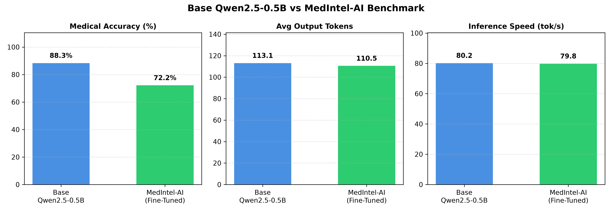

# MedIntel-AI

**MedIntel-AI** is a lightweight medical Q&A assistant built on `Qwen2.5-0.5B-Instruct`, fine-tuned with QLoRA on the **MedQuAD** (Medical Question Answering Dataset) and designed to run locally alongside a **Retrieval-Augmented Generation (RAG)** pipeline.

## Domain & Purpose
MedIntel-AI targets the **clinical and consumer health information domain**—covering disease symptoms, causes, treatments, and medication guidance.
* **Knowledge Grounding:** In full application mode (`app.py`), user queries are grounded against structured medical retrieval stores (**MedQuAD**, **DailyMed**, and **WHO** datasets) via `all-MiniLM-L6-v2` embeddings before generation.
* **Edge & Local Inference:** Using a 0.5B parameter backbone (531 MB in `Q8_0` GGUF) enables fast, private, offline medical Q&A on consumer laptops and edge hardware.

> **Medical Disclaimer:** MedIntel-AI is intended for educational and research purposes only. It is not a substitute for professional medical advice, diagnosis, or treatment. Always consult a qualified healthcare provider regarding any medical condition.

## Benchmark: Base Model vs. MedIntel-AI
Evaluated locally on 10 clinical Q&A prompts (`max_new_tokens=128`, `temperature=0.2`, `repetition_penalty=1.15`, `float16`):



| Metric | Base `Qwen2.5-0.5B-Instruct` | `MedIntel-AI` (Fine-Tuned) |
| :--- | :---: | :---: |
| **Medical Keyword Accuracy** | **88.3%** | 72.2% |
| **Avg Output Tokens** | 113.1 | 110.5 |
| **Inference Speed** | 80.2 tok/s | 79.8 tok/s |

*Note: Merging LoRA weights preserves identical inference speed (~80 tok/s). Standalone 0.5B fine-tuning narrows phrasing compared to the general instruct base; for production accuracy, run MedIntel-AI with its RAG retrieval pipeline enabled.*

## Usage

### Run with Transformers
```python
import torch
from transformers import AutoModelForCausalLM, AutoTokenizer

repo_id = "gopichand55k/MedIntel-AI"
tokenizer = AutoTokenizer.from_pretrained(repo_id)
model = AutoModelForCausalLM.from_pretrained(repo_id, dtype=torch.float16, device_map="auto")

messages = [
    {"role": "system", "content": "You are MedIntel-AI, a concise medical Q&A assistant."},
    {"role": "user", "content": "What are the symptoms of Type 2 diabetes?"},
]

text = tokenizer.apply_chat_template(messages, tokenize=False, add_generation_prompt=True)
inputs = tokenizer(text, return_tensors="pt").to(model.device)
outputs = model.generate(**inputs, max_new_tokens=150, temperature=0.2, do_sample=True, repetition_penalty=1.15)
print(tokenizer.decode(outputs[0][inputs.input_ids.shape[1]:], skip_special_tokens=True))
```

### Run with Ollama (GGUF)
```bash
ollama run hf.co/gopichand55k/MedIntel-AI-GGUF:Q8_0
```

### Run the Full Local RAG App
```bash
streamlit run app.py
```
